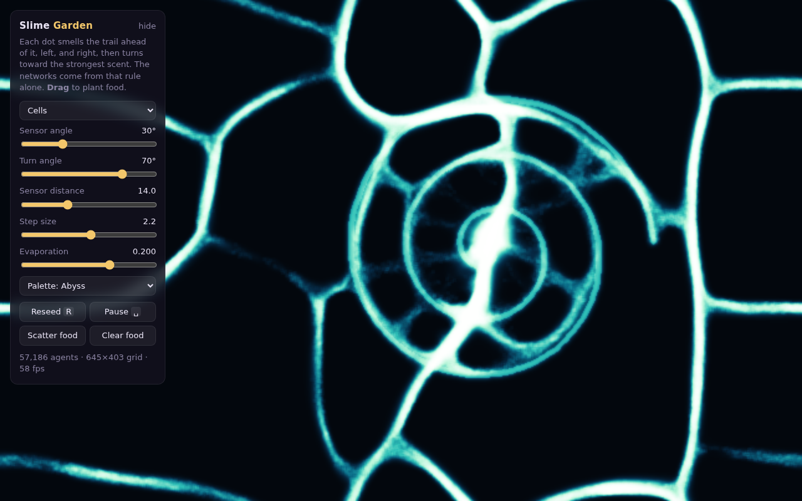

# Slime Garden

A *Physarum polycephalum* (slime mold) simulation in a single HTML file, with no dependencies and no build step. Open `index.html` in a browser.

## How it works

About 57,000 agents move around a grid. Each one follows the same rule:

1. Sniff the trail three times: straight ahead, a little to the left, and a little to the right.
2. Turn toward the strongest scent.
3. Take one step and leave some scent behind.

The trail spreads a little each frame (a 3×3 blur) and evaporates. That's the whole model. The veins, honeycombs and rivers you see all come from that loop. Nobody plans the network; it's what you get when every agent reinforces the paths other agents already like.

This is the agent model from Jeff Jones, *"Characteristics of pattern formation and evolution in approximations of Physarum transport networks"* (2010), which Sage Jenson's work made popular as an art form.

## Playing with it

- **Drag** on the canvas to plant food. The network will reorganize to reach it.
- **Presets** change the five parameters. The sliders change them one at a time.
- **The URL updates as you change things.** Copy the link to share a garden.
- <kbd>Space</kbd> pauses and <kbd>R</kbd> reseeds.

The rendering uses auto-exposure: brightness is scaled to the average trail density. That way sparse patterns (Rivers) and dense ones (Microbes) both stay readable instead of washing out.
