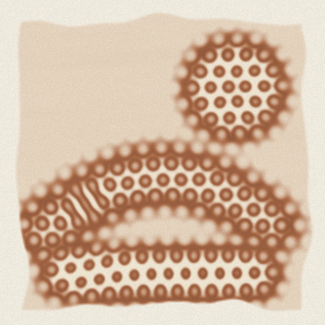

# Faint Traces

*A photogenic drawing you cannot draw.* A single HTML file with no dependencies. Open `index.html` in a browser.

1. **Salt the paper.** Your strokes don't draw the image. They lay down salt.
2. **Carry it into the sun.** Over one simulated day, light darkens the silver according to the ratio of salt to silver at each point. Your pointer's shadow falls on the paper and prints too.
3. **Fix it in strong brine.** Until you do, the paper keeps darkening in any light.

## Where it came from

The repo was wiped, and the brief was: get random words, follow the rabbit holes, and make something original. The words, drawn with a CSPRNG from the `random-words` npm list, were **beautiful, draw, beside, relationship, salt**.

- **draw / beside / beautiful:** In 1833, beside Lake Como, Henry Fox Talbot couldn't draw the view. His pencil left "only faint traces." That failure led him to invent photography on salted paper.
- **relationship / salt:** Talbot found that sensitivity depended on the *ratio* of salt to silver. A little salt (silver in excess) made the paper very sensitive. A lot of salt made it inert, and strong brine became his first fixer.
- **salt (again):** Salt flats crack into polygons 1–2 m across because brine convects in the soil beneath the crust, and the cells are about as wide as the convection is deep (Lasser et al., *Phys. Rev. X* 13, 011025, 2023).
- **beside:** *ekstasis*, "standing beside/outside oneself." Photograms are shadows of whatever lay beside the paper. Here, that's your hand.

## The model

- **Brine convection:** Swift–Hohenberg equation with a quadratic term, solved pseudo-spectrally with a hand-written FFT. It goes unstable only where salt was laid, and settles into hexagonal cells. Their wavelength comes from the *Depth of the brine* slider, following the Lasser result that cells are as wide as the convection is deep.
- **Salt transport:** conservative upwind drift toward downwelling regions plus diffusion. Salt piles up into ridges at the cell boundaries.
- **Photochemistry:** sensitivity is `(0.03 + x)·e^(−x)`, where `x` is the salt-to-silver ratio. It peaks when silver is slightly in excess and falls toward zero in brine. Heavy salt therefore prints white, and thinly salted cell interiors print darkest.
- **Process details:** silver brushed on by hand (ragged edges, faint streaks), the purple-brown of printed-out silver chloride, and the shift to warm brown after fixing, as real salt prints do.
